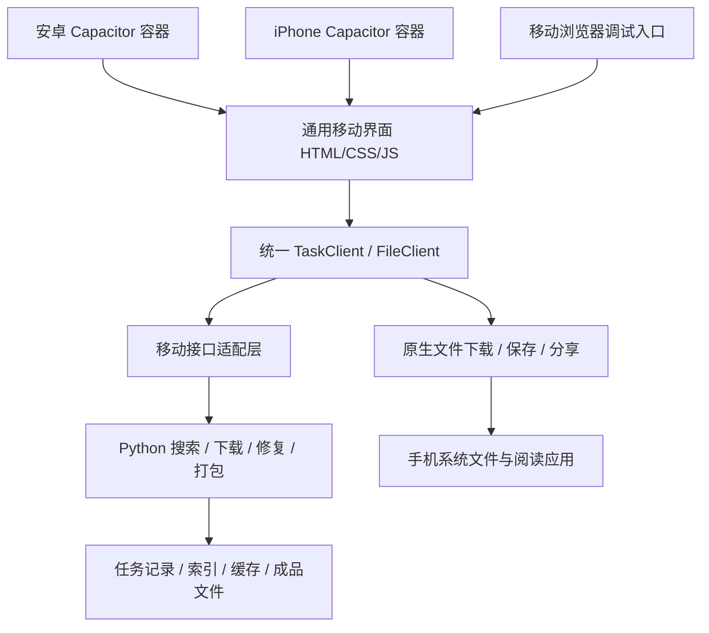

# 书包移动端迁移方案

基线：桌面版 1.8.2。核对日期：2026-10-25。目标：安卓和 iPhone 共用产品体验。

本次交付是迁移方案与可操作原型；原型不是 APK、IPA，也没有连接真实下载服务。桌面版继续按原方式运行。

## 1. 结论与边界

推荐第一版采用 **共用移动网页界面 + 独立的 Python 任务服务**；正式安装版使用 Capacitor 容器接入安卓和 iOS 的文件、分享及生命周期能力。界面仍用现有 HTML/CSS/JavaScript，不先换前端框架。任务服务保留现有搜索、匹配、书源、缓存、修复和打包内核。

组织原则是“找到一本 → 确认作品 → 获取 → 保存到手机”。全局仅保留找书、雷达、书包、设置四个入口；当前作品与任务状态贯穿页面。

这里的“完整平移”指功能和作品身份不丢失、操作适合手指、结果能真正保存到手机，并非把 Windows 页面等比例缩小。以下差异必须明说：

- 共用网页界面不能直接执行现有 Python 内核。任务执行端需要在线；开发时可用电脑，正式使用可用自部署服务。采用远端服务后，手机可以离开电脑使用，但有服务维护、流量和存储成本。
- 安卓与 iOS 安装包不等于任务已经具备后台执行能力。推荐让任务服务负责找书、抓取、修复、打包；手机负责接收进度、下载最终文件并导出。
- 如果后续要求“完全不依赖电脑或服务器”，应单列为端侧执行项目。安卓可评估嵌入 Python；iOS 的执行、下载和恢复要单独适配。这不应被承诺成简单套壳即可完成。

Capacitor 支持用共用 Web 界面连接 Android/iOS 原生能力；它本身不负责运行这套 Python 后端。[官方说明](https://capacitorjs.com/docs)

## 2. 已核实的当前状态

| 当前事实 | 证据 | 对迁移的影响 |
| --- | --- | --- |
| 界面是静态 HTML/CSS/JS，业务由 Python 执行 | web/index.html、app.py | 可以共享界面设计和接口，不必重写匹配算法 |
| 服务仅绑定 127.0.0.1 | app.py 的 AppServer 初始化 | 手机目前不能直接访问电脑上的服务；本原型也没有擅自开放端口 |
| 一个 Engine 同时运行一批任务，批内并发独立控制 | bookpack_core.py 的 create、_start | 移动端应保留“当前任务”的语义，不能默认已支持多人共享队列 |
| 任务与缓存位于程序目录，使用相对批次目录 | Engine.home、output、state_file | 文件与任务迁移要作为整体处理，不能只复制任务记录 |
| 繁简归一化使用 Windows LCMapStringW | bookpack_search.py 的 normalize | 迁到 Linux 或手机执行时，必须补跨平台繁简转换，并保留匹配顺序 |
| “打开文件夹”调用服务主机的系统文件管理器 | app.py 的 /api/open-folder | 手机必须替换为保存到文件、分享或用其他应用打开 |
| 雷达内置四份 2026-10-13 快照，共 740 条榜单记录 | data/radar 的四份 JSON | 允许离线浏览，必须显示快照日期，不冒充今日榜单 |
| 已有获取、重试、停止、候选选择、ZIP 下载、雷达筛选与刷新接口 | app.py 路由、Engine、RadarService | 移动 API 可先适配原内核，再补文件导出与恢复语义 |

“740 条”是四份榜单记录总数，同书可能出现在不同榜型；不是 740 部去重作品。原型只使用这些随包快照，不读取用户的任务、下载文件或私人配置。

## 3. 信息结构与移动交互

完整页面图见 [SITEMAP.mmd](SITEMAP.mmd)，导航与命名规则见 [NAVIGATION.md](NAVIGATION.md)。

| 入口 | 首屏只解决的事 | 次级操作 |
| --- | --- | --- |
| 找书 | 输入书名，选中准确作品 | 书名补全、作者区分、粘贴书单、链接/清单导入 |
| 雷达 | 看榜单并选下一本 | 男/女频、阅读/新书、书名作者检索、筛选、分类热度、热词、刷新 |
| 书包 | 看正在进行的任务和已有文件 | 任务详情、候选改选、停止、继续获取、修复正文、保存、分享 |
| 设置 | 管理来源、服务连接和外观 | 设备文件导入、缓存、海面、日光、白膜、减少动态 |

### 找书

- 搜索框与主要按钮进入拇指可达区域；输入字体不小于 16px，主要触控区域至少 44×44 CSS 像素。这是本方案的布局要求，不是设备像素换算。
- 联想保留“本地优先、在线补入”、中文输入法组词、旧请求失效、准确书名与作者交接。建议列表在页面内展开，避免在软键盘上方再叠一个狭窄浮窗。
- 同名书显示作者与已核实作品平台；下载书源另列。点击候选后立即显示该书的任务详情，状态变化不得把用户滚回页面顶部。
- 批量书单和链接导入进入“导入书单”面板，不挤占单本搜索首屏。现有后端解析能力保留；原型只演示逐行书名导入。

### 雷达

- 桌面的弹窗改为独立页面。男/女频、阅读/新书直接可见；分类、完结状态、最低在读、排序进入底部筛选面板。
- 默认单列横向书卡：左侧作品识别区，中间书名/作者/分类/在读，右侧选书入口。长书名换行，不依赖横向滚动阅读。
- 筛选面板使用“重置 / 查看结果”。用户编辑面板时不逐项重复请求，应用后仍在原频道；结果顶部显示筛选摘要。
- 切换榜单保留可见旧结果，并标明正在读取的榜型；只让最新请求生效。失败保留可用结果、原位重试。分页必须保留原卡片与滚动位置。
- 分类热度和书名热词折叠到“榜单发现”，展开后继续可点击筛选。快照日期始终可见。
- 沿用 1.8.2 的 500ms 面板/结果过渡，轻触反馈保持短促；选书后搜索与退场并行。连续切换取消上一次结果动效。

### 任务和文件

- 页内显示“找书 / 获取 / 打包 / 完成”四阶段。只有已知总量时显示比例；无法得知时显示当前动作。保留缺章、文件不完整、来源失败的原始含义。
- “切换页面”“关闭应用”“停止任务”是三种不同动作。前两种不发送停止请求；重新打开按任务 ID 恢复状态。
- 原“打开文件夹”替换为“保存到文件”和“分享”。远端已生成 ZIP、ZIP 已下载到手机、用户已导出是三个不同状态，不能合并成一个完成勾选。
- 文件不存在时提示重新打包或再次获取，不伪造“已经保存在手机”。已存在有效文件时可以重新导出。
- 保留同名作品改选、已有文件下载、正文修复与继续未完成任务。待选任务需要明显的“请选择作品”状态。

## 4. 功能迁移对照

| 原能力 | 移动端落点 | 实现方式 | 本原型覆盖 |
| --- | --- | --- | --- |
| 书名搜索与作者交接 | 找书、任务详情 | 复用 suggest/start/choose 与匹配内核 | 快照检索、精确选择、带作者进入演示任务 |
| 联想、错字、繁简与别名 | 找书 | 正式版复用后端算法；Linux 补繁简适配 | 书名/作者包含查询；未冒充完整算法 |
| 作品平台和下载书源区分 | 候选与任务详情 | 保留 platform 与 source 两组字段 | 显示快照已知的番茄平台 |
| 本地 TXT/EPUB 与文件夹来源 | 导入、设置 | 手机系统文件选择后上传/导入；不沿用电脑绝对路径 | 方案；未假装访问手机目录 |
| 书单、链接、CSV/JSON 批量导入 | 找书次级面板 | 复用 preview/parse_titles/parse_tasks | 逐行书名解析预览，逐本发起演示 |
| 多源检索、镜像、暂避、换源 | 任务服务 | 复用 SearchService、SourceManager | 列入正式功能范围；未联网测试书源 |
| 整本优先、逐章回退、分页、并发 | 任务服务 | 复用 bulk/content/core | 演示阶段变化；未抓取真实小说 |
| 缓存续取、停止、重试 | 书包、任务详情 | 复用 cancel/retry 与有效章节缓存 | 演示停止、继续、刷新页面恢复 |
| 缺损提示与修复 | 任务详情 | 保留 content_issues 及修复报告 | 错误演示状态与重试；未模拟“已验证正文” |
| TXT/EPUB、ZIP 和报告 | 文件详情 | 复用打包，新增系统导出适配 | 实际生成并保存一个原创演示 ZIP |
| 雷达四榜、全部筛选、分页 | 雷达、底部筛选 | 复用 RadarService | 四份真实快照、过滤、排序、追加 |
| 热度、热词、名次对比 | 榜单发现 | 复用 analysis 与快照比较 | 快照热度/热词；单日数据无名次对比 |
| 榜单刷新、分类进度 | 雷达 | 服务后台刷新，手机只接收进度 | 明确展示离线快照说明；不伪造在线刷新 |
| 海面、日光、白膜与动效 | 设置、全局 | 共用参数；手机采用轻量渲染并可切静态 | 原海面资产、三预设、滑杆、动态开关 |
| 任务记录、来源设置与索引 | 服务及设备存储 | 版本化迁移，保留稳定 ID 与相对路径 | 仅原型设置和演示任务在本浏览器保存 |

## 5. 运行架构与接口

### 代码复用与需要改动的边界

1. 保留 bookpack_match、suggest、sources、content、bulk、lightnovel、platforms、radar 的职责。移动 UI 不复制匹配阈值和书源规则。
2. 将 app.py 的 HTTP/UI 启动职责与 Engine 生命周期分开，执行端独立于客户端存活。按工作区保存现有相对目录，先使用私有单用户服务，避免把当前单 Engine 当成多人任务系统。
3. 提供 TaskClient 适配原接口，视图只消费“作品、任务、文件、榜单”对象。首版前台继续使用现有精简状态轮询；页面恢复立即拉取，后台停止无意义的页面轮询。
4. 移动端增加请求幂等标识，网络重发不重复建立同一批任务。服务端返回稳定任务 ID，连接中断只改变连接提示，不把任务判为失败。
5. 繁简转换替换为跨平台适配器，使用现有案例比较候选集合与顺序；不能只测试模块可导入。
6. 既有单用户任务文件可继续作为第一版兼容存储。需要多人部署时，再做工作区隔离、持久队列及并发存储；不是把一个现有运行目录直接共享给所有人。

| 现有接口 | 移动端处理 |
| --- | --- |
| POST /api/suggest、/api/preview、/api/start | 保留；增加请求 ID 与启动后恢复语义 |
| GET /api/state | 适配为当前工作区的精简任务列表，移除电脑绝对路径 |
| POST /api/choose、/api/cancel、/api/retry | 保留，按任务与候选稳定 ID 操作 |
| GET /api/archive/:id | 保留 ZIP 内容；正式版补文件大小、校验标识、Range 续传与稳定下载语义 |
| /api/radar、/api/radar/status、/api/radar/refresh、/api/radar/select | 保留过滤参数、快照日期和准确作品信息 |
| /api/sources、/api/web-sources | 置于设置；本地目录改用设备导入映射 |
| /api/open-folder、/api/shutdown | 不放进移动产品接口；改为设备文件动作和正常应用生命周期 |

以上是拟实现的接口适配要求，不表示现有 1.8.2 已具备远程服务、幂等重发或文件 Range 续传。

## 6. 安卓与 iPhone 的共同点和差异

| 事项 | 安卓 | iPhone | 共用规则 |
| --- | --- | --- | --- |
| 页面与作品状态 | 共用 Web UI | 共用 Web UI | 同一数据模型、中文交互和半秒雷达过渡 |
| 保存文件 | 系统文档选择器创建文件 | 系统文件导出 / 分享面板 | 用户选择目标；取消面板不记作导出成功 |
| 分享到阅读器 | 原生分享 / FileProvider | 原生分享 | 传实际本地文件，不传电脑路径 |
| 手机接收 ZIP | 原生下载适配 | background URLSession 下载适配 | 临时文件校验后转永久文件；支持恢复与重新导出 |
| 抓取和打包 | 独立任务服务 | 独立任务服务 | 手机退后台不影响服务上的任务；服务故障按已保存检查点恢复 |
| 返回操作 | 系统返回先收面板、再退详情 | 导航返回与边缘返回 | 切换四个主入口保留各自滚动位置和筛选 |
| 构建环境 | Android Studio 工具链 | macOS + Xcode | 本次 Windows 原型不宣称已经生成 iOS 安装包 |

安卓系统文档框架提供创建与选择文件的系统界面；这也是替换 Windows 文件夹动作的依据。[Android 官方文档](https://developer.android.com/training/data-storage/shared/documents-files)

Apple 的后台 URLSession 可以在应用挂起期间接收文件，但需要原生会话配置、恢复和临时文件处理，不能由普通页面定时器替代。[Apple 官方文档](https://developer.apple.com/documentation/foundation/downloading-files-in-the-background)

若将来做安卓端侧执行，长时间 WorkManager 任务仍有系统约束；Android 16 的额度变化也需要适配，不能承诺后台永不停止。[Android 官方文档](https://developer.android.com/develop/background-work/background-tasks/persistent/how-to/long-running)

浏览器分享能力不在所有环境可用，原型探测支持后调用；正式容器使用原生分享适配。[MDN](https://developer.mozilla.org/en-US/docs/Web/API/Web_Share_API)、[Capacitor Share](https://capacitorjs.com/docs/apis/share)

## 7. 视觉、手势和性能约定

- 保留海面、蓝色字、玻璃亮边、三种组合反馈。正文优先使用清晰的实色文字；不把小字号当成容纳更多内容的办法。
- 原型建议手机白膜默认 22%，高于桌面默认的 10%，以减轻海面细节对小屏文字的干扰；这是设计取舍。滑杆保留 0–40% 范围，正式迁移已有设置时优先保留用户值，不强制重置。
- 主按钮与图标按钮最小触控区域 44×44px；列表文字 14–16px，输入 16px，次要文字不小于 12px。尊重系统字级，长标题自然换行。
- 主页面固定顶部标题和底部四入口，中间只有一个主要滚动容器。底部面板独立滚动；横屏和软键盘出现时保留关闭和主操作。
- 使用动态视口与安全区；窄屏、刘海、底部手势条不能遮挡操作。键盘收起优先于退出搜索，不把返回手势等同停止下载。
- 按压约 150ms、水波约 440ms、雷达主过渡 500ms。系统减少动态开启时停用位移、水波和旋转；保留文字与进度变化。
- 手机海面提供动态/静态选择；前台以外暂停视觉动画。正式动态海面先按中低档设备设预算，再实测是否保留 WebGL。原型使用已有海面图与轻量位移，没有声称已完成真机能耗验证。
- 重要状态不能只靠一瞬间的提示条：选书、进行中、失败、完成均在页面内保留；提示条只用于“设置已保存”“导出已发起”等短反馈。

## 8. 实施顺序和完成标准

| 阶段 | 具体交付 | 完成标准 |
| --- | --- | --- |
| 本次：方案与原型 | 本文、页面图、导航规则、可操作原型 | 四入口、真实快照筛选、连续选书、演示任务、实际演示 ZIP 可操作；清楚标注演示范围 |
| 共用移动功能版 | TaskClient 连接隔离的真实执行端 | 用本地原创文件跑通真实搜索、候选、获取、打包、断连恢复、保存；桌面结果与移动结果逐字节一致 |
| 双平台设备适配 | 安卓/iOS 原生文件及生命周期桥接 | 真机验证系统返回、软键盘、系统文件导出、分享取消、锁屏后恢复和大文件接收 |
| 安装与交付 | 安卓可安装包、iOS 可测试构建、启动说明 | 在目标真机实际安装；已有数据升级后可继续取用，不能用浏览器模拟通过代替真机验收 |

验收只围绕交付功能。失败、空结果、断网、重复点按、停止续取、大文件及键盘是这条使用链的必要情况，不另加无关审核或确认步骤。

### 成本与还未被验证的变量

- 共用 UI 降低重复实现，但原生文件桥接和真机验证仍需分别完成。iOS 构建需要 macOS/Xcode；本机 Windows 无法独立完成该环节。[构建环境要求](https://capacitorjs.com/docs/getting-started/environment-setup)
- 正式远端服务需要计算、磁盘、出站流量、备份和来源规则维护。文件大小、并发用户和保存时长尚未确认，不给出虚假的月费或工期。
- 服务访问来源网站的位置会影响网络速度、编码及可用性；桌面一次成功不能证明手机网络或服务器位置同样成功。
- 当前“本地书库”指执行端文件。部署到远端后，电脑文件不会自动出现，手机文件也要显式导入。离线能力优先覆盖界面、快照和已保存的文件，不承诺离线获取尚未下载的正文。
- 当前匹配、修复和来源能力有既有边界；迁移不得用“完美”掩盖上游文件缺损、来源失效或后台恢复尚未真机核实。

## 原型使用

打开 prototype/index.html 即可本地查看，也可运行“预览手机版.ps1”后用本机浏览器打开它输出的地址。该预览服务仅监听本机，不会自动让手机通过 Wi-Fi 连接。

原型使用真实的随包榜单快照；任务进度均为演示，保存的是原创示例《雨后的借书处》及演示说明。原型不会建立真实下载任务，也不会改写现有桌面应用的配置。

核验记录见“验证记录.md”。
